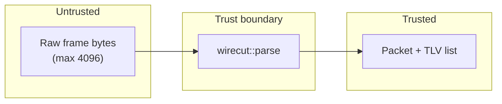

# wirecut

Memory-safe-oriented parser for **WCT1** custom telemetry frames (not DNS),
with a libFuzzer harness and AddressSanitizer / UndefinedBehaviorSanitizer
builds. MIT licensed. Copyright (c) 2025 smae.

Untrusted bytes cross a single trust boundary at `wirecut::parse`. Structured
fields are produced only after explicit size checks; the parser never reads
past the caller-provided buffer.



## Frame format

| Field | Size | Notes |
| --- | --- | --- |
| magic | 4 bytes | `WCT1` |
| version | uint8 | must be `1` |
| n_tlvs | uint8 | number of following TLVs |
| TLV | tag uint8, length uint16 BE, value[length] | repeated `n_tlvs` times |

Rejected: truncated frames, frames larger than 4096 bytes, unknown version,
bad magic, TLV length that would run past remaining bytes, and `n_tlvs` that
cannot be satisfied by remaining bytes.

## Build and test (under 60 seconds)

```bash
make test
```

This configures a Debug CMake build with ASan/UBSan, compiles the static
library and unit tests, and runs `build/wirecut-tests`. Typical runtime on a
laptop is a few seconds.

Optional:

```bash
cmake -S . -B build -DCMAKE_BUILD_TYPE=Debug
cmake --build build
./build/wirecut-parse corpus/valid_empty.bin
make fuzz-short    # Clang + libFuzzer, ~5 seconds
make coverage      # fails if parser.cpp line coverage is under 80%
```

CMake options: `WIRECUT_SANITIZE`, `WIRECUT_FUZZER`, `WIRECUT_COVERAGE`.

## Layout

- `include/wirecut/parser.hpp`, `src/parser.cpp` — parser
- `tests/test_parser.cpp` — vendored assert-based tests (no network)
- `fuzz/fuzz_parser.cpp` — `LLVMFuzzerTestOneInput`
- `corpus/` — valid and truncated seeds
- `src/cli.cpp` — `wirecut-parse` file/stdin TLV summary
